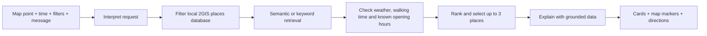

# AstanaWalk

**A weather-aware AI city guide for Astana**  
*Build with AI × NIT Smart City — hackathon prototype*

**AstanaWalk** helps people choose **1–3 places to visit** based on where they are, what they want to do, when they plan to go, and how much time they have. It combines a conversational assistant, an interactive map, a locally collected places database, walking estimates, and the weather forecast for the selected time.

> **Астана под ваши планы:** куда поесть, погулять или развлечься рядом с вами — с учётом времени, погоды и доступной информации о местах.

**Demo area:** a fixed **2 km radius around Khan Shatyr, Astana**. This is the scope of our first prototype, not a citywide coverage claim.

## What you can do

- **Find food:** cafés, restaurants, and coffee shops; filter by known average bill, Wi-Fi, laptop-friendly information, or children's menu.
- **Go for a walk:** discover parks, public spaces, and attractions near your selected point.
- **Have fun:** explore museums, galleries, VR venues, quests, and family activities available in our dataset.
- **Plan for later:** choose now, in two hours, or a specific time within the available forecast; set how long you have.
- **Compare alternatives:** see **1–3 individual recommendations** with reasons, available opening information, estimated walking time, and relevant weather notes.
- **Explore on the map:** set your starting point, view recommended places, and open walking directions in 2GIS.
- **Learn about landmarks:** read short sourced facts where supported (currently Khan Shatyr).

The UI is in **Russian**. You can use the filters without sending a chat message, or describe your plan in natural language.

## How it works

AstanaWalk uses **retrieval-augmented generation (RAG)**. We **do not train a new AI model**: Gemini helps interpret the request and explain recommendations, while the place names and supported attributes come from retrieved records.



**Grounding matters:** the app distinguishes a **confirmed attribute**, an **unknown value**, and an **estimated or AI-suggested activity**. Missing data is *not* proof a service exists or a place is unavailable. If Gemini is slow or unavailable, a labelled **database-backed fallback** can still return suitable candidates; it is not presented as a normal Gemini answer. If there are no qualifying places, the app says so rather than inventing one.

### Technology

| Component | Technology / source |
|---|---|
| Frontend | HTML, CSS, browser JavaScript modules, Leaflet |
| Backend | Node.js HTTP server (no app runtime npm dependencies) |
| Places | 2GIS Places API; locally saved and filtered records |
| Walking estimates | 2GIS Routing API |
| Forecast | Yandex Weather GraphQL API |
| Language model | Google Gemini |
| Semantic retrieval | Gemini embeddings + locally stored vectors; keyword fallback |
| Map tiles | MapTiler in the current local demo, with OpenStreetMap attribution |
| Landmark facts | Wikipedia API (Khan Shatyr) |

## Run locally

**Requirements:** Node.js **22.16+** and access to the external APIs. Run these commands in the `AstanaWalk` directory, which contains `package.json`.

```bash
cp .env.example .env
# Add your own credentials to .env
npm run doctor
npm test
npm start
```

On Windows PowerShell, use `Copy-Item .env.example .env` instead of `cp`.

Open **http://localhost:3000**. Stop the server with **Ctrl+C**. Restart it after changing `.env` or backend files.

Add your credentials to `.env` (never commit this file):

```dotenv
TWOGIS_API_KEY=your_2gis_key
YANDEX_WEATHER_KEY=your_yandex_weather_key
GEMINI_API_KEY=your_gemini_key
```

Other configuration, including model names, port, optional demo authentication, and collection limits, is documented in [`.env.example`](.env.example). An API key being present does not guarantee that its account has access or remaining quota.

**Map setup:** the running local version uses MapTiler raster tiles in `public/map.js`. If you clone or share this project, configure a **new MapTiler browser key** according to your account's settings and restrict allowed origins for your deployed domain. Do not commit private backend credentials or reuse a publicly shared key. The map requires internet access.

### Important: the dataset is not automatically included in a public clone

The team currently has a **105-place snapshot** and matching embedding vectors, selected from our original collected records within the 2 km demo area. They are **not freshly verified live data**. `data/*.json` is excluded from Git by default because the rights to redistribute third-party records and derived data have not been established.

For a **private demo**, use the locally held, authorized snapshot with its matching embedding index. For a **fresh clone**, first obtain an authorized place dataset and build its vectors:

```bash
npm run collect    # uses 2GIS; makes external requests
npm run index      # uses Gemini embeddings; may incur API usage
```

Or run `npm run refresh` to execute those sequentially. The collection script is **manual, not scheduled**. It performs a bounded search around Khan Shatyr; this is not an exhaustive directory of Astana. Check usage, caching, storage, map-display, and attribution conditions with each provider before collecting or publishing the results.

## Try these scenarios

1. **Café with a time and budget:** “Через 2 часа хочу поесть. У меня 90 минут и бюджет 7000 тенге.”
2. **Walk with weather:** “Хочу погулять через 2 часа. У меня 1 час. Посоветуй интересное место поблизости, учитывая погоду.”
3. **Specific amenities:** “Нужна кофейня с Wi-Fi, где можно работать с ноутбуком.”
4. **Limited results:** Set strict filters or a short time window. The app should explain that no place meets them instead of making up a result.
5. **Map start point:** Click inside the demo boundary and compare walking estimates from the new position.

For scenario steps, expected outcomes, and failure cases, see [test scenarios](docs/TEST-SCENARIOS.md).

## Tests and useful commands

| Command | Purpose |
|---|---|
| `npm run doctor` | Check project readiness and required configuration |
| `npm test` | Run backend and integration regression tests |
| `npm start` | Start the local web application |
| `npm run collect` | Update places from 2GIS (quota and permissions required) |
| `npm run index` | Build/update stored embeddings |
| `npm run refresh` | Collect, then index |
| `npm run smoke:live -- --confirm-live` | Opt-in calls to real connected services; consumes quota |

Offline automated tests use mocked providers and **do not guarantee live API availability, recommendation quality, or deployment readiness**. Before a hackathon demo, manually test chat, weather, routing and the map with your own service access.

## Privacy, data integrity and limitations

- **Location:** users select a point; coordinate-based requests are sent to services required for weather and routes. Avoid entering sensitive personal data in chat.
- **Sources:** place information is sourced from records collected through 2GIS; weather from Yandex; landmark text from Wikipedia. Records can become outdated.
- **Unknown does not mean false:** opening hours, ticket prices, age limits, seats, reservations, and amenities are not guaranteed unless the source actually supplies them.
- **Travel estimates:** walking time is approximate; return-trip time is **not included**. No live taxi prices or public transport schedules are promised.
- **Weather:** recommendations can use the forecast for the chosen time window when sufficient hourly data is available; the app should disclose missing forecast information.
- **Coverage:** only the fixed Khan Shatyr area is supported, regardless of the wording of a chat request; no multi-stop itineraries in this version.
- **Provider failures:** Gemini may be slow; fallbacks are identified. If external services fail, parts of the experience may still work from local records.
- **Publication:** review provider rights and the client-side MapTiler key configuration before pushing or deploying. Never commit `.env`.

See [RAG, privacy and limitations](docs/RAG-AND-PRIVACY.md) and [source-data rights](docs/DATA-RIGHTS.md) for details.

## Project structure

```text
AstanaWalk/
├── public/          # Website: chat, map, cards and styles
├── src/             # HTTP server, recommendations, RAG and providers
├── scripts/         # Collection, embedding index and diagnostics
├── test/            # Automated checks
├── docs/            # Tests, privacy, data rights and demo material
├── data/            # Local source records and embedding index (not for public Git by default)
├── .env.example     # Example configuration, without keys
├── package.json
└── README.md
```

### Hackathon resources

- [Test scenarios](docs/TEST-SCENARIOS.md)
- [Technical audit](docs/AUDIT.md)

---

**AstanaWalk — explore Astana with context, not guesses.**  
*Build with AI · NIT Smart City*
